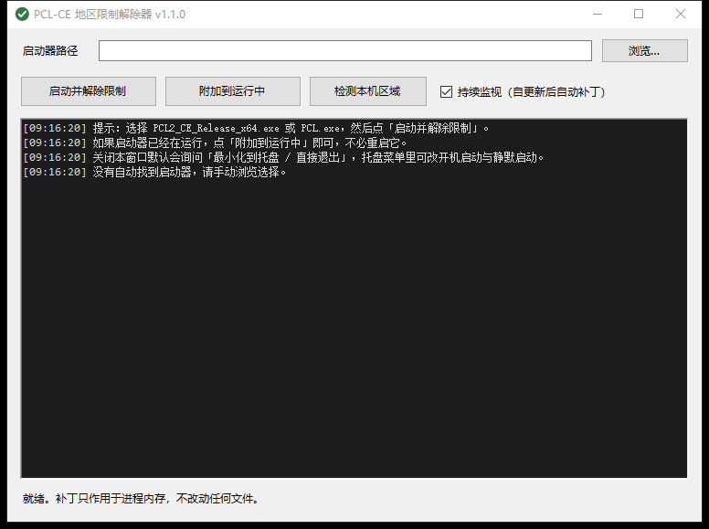
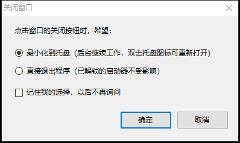

# PCL-CE 地区限制解除器

[](https://github.com/Anchenqua/PCL-CE-Region-Bypass/actions/workflows/ci.yml)
[](https://github.com/Anchenqua/PCL-CE-Region-Bypass/actions/workflows/release.yml)


在 **进程内存** 里把 PCL-CE 用来判断「你在哪个国家/地区」的几个 Windows 查询函数改写掉，让它认为你在美国，
从而恢复 Minecraft 下载、补全、安装与整合包功能。

**不改动任何文件、不需要管理员权限、不依赖 PCL-CE 的具体版本。**

> [!WARNING]
> **本项目是非官方的技术实验，与 PCL-CE / Mojang / Microsoft / 网易均无关联。**
> 它解除的是「地区可用性判断」，**不是授权** —— Minecraft Java 版仍需你自行合法购买。
> 上游加入该限制是为应对发行区域的合规要求，在受限制地区绕过它可能违反服务条款或当地法律，
> **后果自负**。使用前请完整阅读 [DISCLAIMER.md](DISCLAIMER.md)。



> 代码由 AI 生成（DeepSeek Harness / deepseek-flash），已在本机真实环境中编译与测试，
> 详见 [关于作者与 AI](#11-关于作者与-ai)。

---

## 1. 限制是怎么加进去的

`PCL-Community/PCL-CE#3673`（`fix(install): 中国大陆地区禁用 Minecraft 安装功能`，已于 2026-10-20 合入 `dev`）
新增了 `PCL.Core/App/Region/RegionPolicy.cs`，读取本机的若干「区域信号」后给出结论，
再由 `Plain Craft Launcher 2/Modules/Minecraft/RestrictedFeaturePolicy.cs` 在各功能入口拦截：

```csharp
internal static bool Check(string feature, bool showHint = true)
{
    var assessment = Assess();
    if (!assessment.IsRestricted) return true;   // 放行
    ...
    return false;                                 // 拦截并提示
}
```

被拦截的入口：`McDownloadClient`、`McInstall`、`McDownloadMenuSave`、`BtnManageCheck`（补全）、
`ModpackInstall`（本地/在线整合包）、`auto-modpack-install`，以及「本地文件不全时的启动」。

### 判定逻辑（`dev` 分支现状，比 PR 多一层）

| 顺序 | 条件 | 结论 |
|---|---|---|
| 1 | `GetUserDefaultGeoName` 返回 `CN` / `156` | **中国大陆 → 受限** |
| 2 | HKLM `…\Control Panel\DeviceRegion\DeviceRegion` == `45` | **中国大陆 → 受限** |
| 3 | 时区 ∈ {`China Standard Time`, `Asia/Shanghai`, `PRC`} **且** 区域或首选 UI 语言是 `zh-CN` | **中国大陆 → 受限** |
| 4 | 第 1 条的地区名是合法的两位非 CN 国家码 | 其它地区 → **放行** |
| 5 | 地区名不可用，但时区非中国 且 区域是明确的其它地区 | 其它地区 → **放行** |
| 6 | 其余（信号缺失/不足） | 未知 → **受限** |

第 2 条是 PR 合入后追加的：它读**设备安装（OOBE）时选择的区域**，和用户可以随便改的「用户区域」分开，
所以「只把 Windows 区域改成美国」在部分机器上会失效。第 3 条要求时区与语言**同时**满足，
所以只改地区名也不够 —— 用户机器上的日志正好把这两种情况都记录了下来（见第 6 节）。
本项目把这三类信号一起处理。

---

## 2. 为什么选择「进程内 API 拦截」

| 方案 | 结果 |
|---|---|
| 改源码重新编译 | 可行但要求 .NET 10 SDK，且每次上游改动都要重新跟进 |
| 直接改 exe / IL | 发布版是 23 MB 的 **单文件自包含 exe**，托管程序集在 bundle 里，改 IL 需要重打包，不现实 |
| **进程内 API 拦截（本项目）** | 与版本基本无关，不改文件，不改系统设置 ✅ |

PCL-CE 的判定全部来自本机的一次性查询，且**每次调用都重新求值**（`Assess()` 没有缓存），
所以只要在它调用那几个 Win32 函数时给出假数据，判定就一定翻成「Other / 放行」。

### 拦截清单

| 模块 | 函数 | 伪装结果 |
|---|---|---|
| kernel32 | `GetUserDefaultGeoName` | 写入 `"US"`，返回 3 |
| kernel32 | `GetUserGeoID` | 返回 `244`（美国） |
| kernel32 | `GetUserDefaultLocaleName` | 写入 `"en-US"`，返回 6 |
| kernel32 | `GetUserPreferredUILanguages` | 报告 `1` 种语言 `"en-US"`，需 6 个字符 |
| advapi32 | `RegQueryValueExW` | 值名等于 `DeviceRegion` 时返回 `ERROR_FILE_NOT_FOUND` |
| advapi32 | `RegGetValueW` | 同上 |

注册表钩子是**带透传**的：值名不匹配（包括只差一个字符的 `DeviceRegio`）时跳回真实实现，
PCL 的其它注册表访问（Java 查找、配置等）完全不受影响。

### 三批挂载，以及为什么要分批

| 批次 | 内容 | 时机 | 原因 |
|---|---|---|---|
| ① Core | 地区名、地区 ID | 进程刚起来 | 无副作用，越早越好 |
| ② Locale | 区域、UI 语言 | **等主窗口出现后** | 见下 |
| ③ Registry | `DeviceRegion` 值名 | 等目标进程加载 `advapi32.dll` 后 | 启动早期该模块还没被加载 |

第 ② 批延后是关键设计。`.NET` 的 `CultureInfo.CurrentCulture` 本身就来自 `GetUserDefaultLocaleName`，
而 PCL 的界面语言默认是 `auto`（跟随系统语言，`Config.Preference.Localization.Language = "auto"`）。
如果启动前就把语言伪装成 `en-US`，PCL 的界面会整个变成英文。
等主窗口初始化完（此时 `CultureInfo` 已经定型）再挂钩子，就只影响后续的判定查询，
界面语言、日期/数字格式都保持中文 —— 自动化测试 C 专门验证了这一点。

---

## 3. 使用

### 图形界面

双击 `bin\PCLRegionBypass.exe`：

- **启动并解除限制**：选好 `PCL2_CE_Release_x64.exe`（或改名为 `PCL.exe`）后启动；会自动探测同目录/上级目录
- **附加到运行中**：启动器已经开着时用这个，不必重启它（会优先挑有窗口的 `PCL*` 进程）
- **检测本机区域**：打印六个信号与最终判定，相当于「PCL 眼里的你」
- **持续监视**：PCL 自更新后会重启自己，监视器会给新进程重新打补丁
- 支持把 exe 拖进窗口；上次用过的路径会记住（`%APPDATA%\PCLRegionBypass\settings.ini`）

### 托盘、开机启动与静默启动

程序常驻托盘（右下角绿色对勾图标），关掉窗口也不会中断正在运行的启动器。

| 功能 | 说明 |
|---|---|
| **托盘菜单** | 显示主界面 / 附加到运行中的 PCL / 开机启动 / 静默启动 / 退出；双击图标打开窗口 |
| **开机启动** | 写 `HKCU\…\CurrentVersion\Run`（不需要管理员、不建计划任务）；程序被移动后会在下次启动时自动修正路径 |
| **静默启动** | 启动时不显示窗口、直接进托盘，并弹一个气泡提示；对「开机启动」和手动双击都生效 |
| **单实例** | 已经在托盘里时再双击 exe，不会开第二个，而是把已有窗口唤出来 |

关闭窗口时默认会问一次：



选「最小化到托盘」就只是隐藏窗口（后台继续监视），选「直接退出」则进程结束（已经解锁的启动器不受影响）。
勾上「记住我的选择」后不再询问，之后可以在托盘菜单或删除 `settings.ini` 里的 `CloseAction` 重新变成询问。

`--silent` 可以在命令行强制静默启动；`--set-autostart on|off` 可以在脚本里开关开机启动。

### 命令行

```powershell
# 查看本机信号和判定结果
PCLRegionBypass.exe --inspect

# 静默启动：不显示窗口，直接进托盘
PCLRegionBypass.exe --silent

# 开关开机启动
PCLRegionBypass.exe --set-autostart on
PCLRegionBypass.exe --set-autostart off

# 启动并解锁；`--` 之后的参数原样传给 PCL
PCLRegionBypass.exe --exe "F:\File\PCL2CE\PCL2_CE_Release_x64.exe" -- --launch 1.20.1

# 已经手动启动了 PCL，只想补一下
PCLRegionBypass.exe --attach 7344

# 立刻挂全部钩子（会把进程区域性也改掉，仅调试用）
PCLRegionBypass.exe --no-delay --exe ...
```

| 参数 | 说明 |
|---|---|
| `--exe <path>` | 指定启动器路径 |
| `--attach <pid>` | 给已运行的进程打补丁 |
| `--inspect` | 只打印本机信号与判定（含开机启动/静默启动状态），不启动 |
| `--silent` | 静默启动：不显示窗口，直接进托盘 |
| `--set-autostart on\|off` | 开关开机启动（写/删 HKCU 的 Run 项） |
| `--no-delay` | 语言钩子不等窗口，立刻挂载（副作用：进程区域性变 en-US） |
| `--registry-hooks` | 强制挂 `DeviceRegion` 注册表钩子（默认只在检测到设备区域=中国大陆时挂） |
| `--gui` | 强制打开图形界面 |
| `-- <args>` | 透传给启动器的参数 |

---

## 4. 构建

不需要 .NET SDK，用 Windows 自带的 .NET Framework 编译器即可：

```powershell
powershell -NoProfile -ExecutionPolicy Bypass -File .\build.ps1
```

产物 `bin\PCLRegionBypass.exe` 约 58 KB，只依赖 .NET Framework 4.x。

## 5. 自动化测试

```powershell
powershell -NoProfile -ExecutionPolicy Bypass -File .\test.ps1
```

五个测试靶：

- **A** 直接跑「判定逻辑复刻版」（`tests/PolicyTarget.cs`，移植自真实 `RegionPolicy.cs`）→ 应当 `RESTRICTED=YES`
- **B** 经补丁器启动 → `RESTRICTED=NO`，`GeoName=US`、`LocaleName=en-US`
- **C** 两阶段模式（先出窗口、再判定）→ `RESTRICTED=NO`，同时 `CurrentCulture=zh-CN` 未被污染
- **D** 注册表钩子（`tests/RegHookTarget.cs`）→ `DeviceRegion` 被屏蔽，其它值名（含 11 个字符的近似名）照常透传
- **E** 路径容错（`tests/PathUtilTest.cs`）→ 空串、纯空白、非法字符、不存在的目录都不能抛异常

实际输出：

```
[A] baseline: policy target without patches (expect RESTRICTED)
  PASS  baseline is restricted (exit 1)

[B] patched via launcher, immediate hooks
  PASS  patched is unrestricted (exit 0)
  PASS  GeoName spoofed to US
  PASS  LocaleName spoofed to en-US
  PASS  verdict is Other

[C] patched via launcher, deferred locale hooks (window appears first)
  PASS  deferred patch is unrestricted (exit 0)
  PASS  deferred patch still reports en-US locale
  PASS  process culture untouched (zh-CN)
  PASS  process UI culture untouched (zh-CN)

[D] registry DeviceRegion hook
  PASS  without hook the value is readable (exit 0)
  PASS  with hook DeviceRegion is masked (exit 3)
  PASS  hook hides DeviceRegion
  PASS  hook hides DeviceRegion (RegGetValue)
  PASS  other values pass through
  PASS  similar name passes through

[E] path handling (empty / invalid input must not throw)
  PASS  path helper handles empty and invalid input (exit 0)
  PASS  path helper reports all passed

ALL TESTS PASSED
```

## 6. 在真实 PCL-CE 2.15.1 上的验证

发行版：`PCL2_CE_Release_x64.exe` v2.15.1（23,486,024 B，
SHA-256 `168BD8369D5ED4E5478942677562913330EF1D30A5193870AF910BD18198050C`）。

**（1）限制确实存在** —— 这台机器上 PCL 自己的日志 `PCL\Log\Launch-*.log`：

```
[08:17:55.859] [INFO] [STA] [RegionPolicy] 已阻止功能 minecraft-install，判定原因：geo-cn
[08:20:54.069] [INFO] [STA] [RegionPolicy] 已阻止功能 minecraft-install，判定原因：china-time-zone-and-locale
[08:20:54.114] [INFO] [STA] [UI] 弹出提示：Minecraft 下载、补全与整合包安装功能在你所在的国家或地区不可用。
```

第二条正是「改过 Windows 区域、但时区+语言仍是 zh-CN/中国」的情形，说明单改区域名不够。

**（2）补丁能打进真实进程**（对正在运行的 PID 7344 执行 `--attach`）：

```
正在给已运行的进程打补丁：PID 7344
  ✓ 地区名 (GetUserDefaultGeoName) → US
  ✓ 地区 ID (GetUserGeoID) → 244/US
  ✓ 系统区域 (GetUserDefaultLocaleName) → en-US
  ✓ UI 语言 (GetUserPreferredUILanguages) → en-US
完成。
after: alive=True  title='Plain Craft Launcher Community Edition'  responding=True
```

注：该机器 `HKLM\…\DeviceRegion` 不存在，所以第 ③ 批注册表钩子按设计未挂载
（`--inspect` 会直接显示这一点）；对应的逻辑由测试 D 覆盖。

---

## 7. 实现要点（想改代码的话）

```
src/Asm.cs             极简 x64 机器码发射器（带标签/重定位），避免手写十六进制
src/Stubs.cs           每个钩子的跳板桩代码
src/Win32.cs           P/Invoke 与模块枚举
src/PeExports.cs       导出表解析 + 转发桩解引用 + ASLR 地址翻译
src/ProcessBypass.cs   代码洞分配、5 字节 E9 改写、线程冻结、三批挂载、幂等跳过
src/Launcher.cs        启动/附加/监视、等窗口、注册表钩子重试
src/PolicyPort.cs      真实判定逻辑的移植（仅用于诊断与测试）
src/Settings.cs        配置持久化（路径、关闭行为、静默启动）
src/AutoStart.cs       开机启动（HKCU Run 项，含路径自愈）
src/PathUtil.cs        路径容错（空串/非法字符不抛异常）
src/AppIcon.cs         运行时画托盘/窗口图标
src/CloseChoiceDialog.cs  关闭时「最小化到托盘 / 直接退出」询问
src/AppInfo.cs         名称与版本
src/Program.cs / MainForm.cs   命令行 / WinForms 界面（托盘、单实例、静默启动）
```

几个关键细节：

1. **转发桩**：`kernel32!GetUserDefaultLocaleName`、`advapi32!RegQueryValueExW` 这类导出其实是
   7 字节的 `jmp qword ptr [rip+disp32]`。槽位里已经是加载器修正后的真实地址，直接读出来即可，
   **不需要反汇编、也不需要搬移原指令**。
2. **地址翻译**：同一份 DLL 在两个进程里的基址不同（ASLR），一律按 `模块基址 + RVA` 换算；
   真实实现地址同样要先判断「它属于哪个模块」再拼到目标进程。
3. **改写方式**：函数入口写 5 字节 `E9 rel32` 跳到代码洞里的桩，桩末尾 `ret`；
   需要透传的注册表桩以 `mov rax, <真实地址>; jmp rax` 收尾。相对跳转不受 CFG 影响。
4. **线程冻结**：改写前后用 Toolhelp 枚举目标进程线程并 `SuspendThread`，避免写入 5 字节的瞬间有线程正在执行该处；
   三批挂载之间用锁串行化。
5. **代码洞**：必须在目标 ±2 GB 内才能用 `rel32`；按 64 KB 步长在模块附近试探 `VirtualAllocEx`。
6. **幂等**：每个桩前有 8 字节签名 `PCLRBPS1`；再次附加到同一进程时会识别并跳过，
   避免把已被改写的入口误当转发桩而算出指向自身的透传地址。

## 8. 已知限制与风险

- **仅支持 x64**（ARM64 版需要另一套指令编码，未实现）。
- **只对「进程内判定」有效**：如果将来 PCL 改成把判定结果落盘、或由服务端下发，本方案需要跟着调整。
  目前 `Assess()` 每次调用都重新读信号，所以不存在缓存问题。
- **PCL 自更新**：更新后 PCL 会重启自己，钩子随之丢失；开着「持续监视」会自动给新进程补上。
- **权限一致**：PCL-CE 清单是 `asInvoker`，本项目不需要提权；若你用管理员启动 PCL，本项目也要以管理员运行才能注入。
- **重启即恢复**：所有改动都在进程内存里，关掉启动器就完全复原，磁盘上没有任何痕迹。
- **合规提示（请自行判断）**：这段地区限制是上游为了应对发行/授权区域的合规要求而加的。
  本工具只应作用于你自己机器上、你本人有权使用的副本；把改过的启动器再分发出去，风险由你承担。
  另外，Minecraft Java 版本体本身需要有效授权，绕过地区限制并不等于获得游戏授权。

## 9. 仓库结构

```
build.ps1             构建脚本（Windows 自带 csc，无需 .NET SDK）
test.ps1              自动化测试（地区判定 / 相对跳转 / 注册表透传）
README.md
DISCLAIMER.md         免责声明（中文 + English summary）
LICENSE               Apache License 2.0
NOTICE                第三方署名与 AI 生成说明
assets/app.ico        exe 与托盘图标
tools/MakeIcon.cs     图标生成器（仅在改图标时需要跑）
docs/                 README 用截图
src/                  工具源码（见第 7 节）
tests/                测试靶源码（PolicyTarget / RegHookTarget / PathUtilTest）
```

构建产物 `bin/` 不入库；发布二进制请用 GitHub Releases。

## 10. 免责声明

完整版见 [DISCLAIMER.md](DISCLAIMER.md)，要点：

- **非官方**：与 PCL-CE、Mojang、Microsoft、网易无任何隶属或授权关系。
- **不提供授权**：解除的是地区可用性判断，不是正版验证；Minecraft Java 版需自行合法购买。
- **合规自负**：上游的限制是为应对发行区域合规要求而加，在受限制地区绕过可能违反服务条款或当地法律。
- **风险自负**：运行时内存补丁可能导致启动器异常或崩溃；按 AS IS 提供，作者不承担任何损失。
- **禁止**商业使用、二次分发"解锁版"、任何规避授权或违法用途。
- 不包含游戏本体，也不分发被修改的启动器；进程退出后一切复原。

## 11. 关于作者与 AI

本仓库的代码由 **AI 助手生成：DeepSeek Harness，模型 `deepseek-flash`**。

- 需求、取舍与验收由仓库所有者提出，AI 负责设计、实现与自测；
- 所有功能都在真实 Windows 10 x64 环境上编译、注入真实进程并跑过自动化测试
  （第 5、6 节有输出记录），不是"看起来能跑"的示例代码；
- AI 生成的代码仍可能有错误或遗漏，使用前请自行审查，欢迎提 Issue / PR。

提交记录的作者信息为占位身份（`PCL Region Bypass (AI) <noreply@localhost>`），
如需改为你自己的 GitHub 身份，可在克隆后执行：

```bash
git config user.name  "你的名字"
git config user.email "你的邮箱"
git rebase -r --root --exec "git commit --amend --no-edit --reset-author"
```

## 12. 许可

本项目以 **Apache License 2.0** 授权，见 [LICENSE](LICENSE)。

`src/PolicyPort.cs` 是 [PCL-CE](https://github.com/PCL-Community/PCL-CE)（Apache-2.0）中
`RegionPolicy.cs` 判定逻辑的移植版本，仅用于诊断与测试；衍生关系、修改内容与第三方署名见 [NOTICE](NOTICE)。
本仓库不包含 PCL-CE 的其它源码、资源或二进制文件。

## 13. 更新日志

### 未发布（main）

- 新增 GitHub Actions：`ci.yml`（构建 + 全量测试 + artifact）与 `release.yml`（标签校验 + 打包 + 自动发版）
- 测试靶显式模拟中文用户进程，使「界面语言不会被带成英文」这条断言在 en-US 的 CI runner 上同样有效
- `.gitignore` 增加 `dist/`（发布工作流的临时产物）

### v1.1.1

- **修复**：路径框为空时点击「浏览…」抛出 `ArgumentException`（`Path.GetDirectoryName("")`），
  窗口直接崩到「实时(JIT)调试」对话框。现在统一走 `PathUtil.ExistingDirectoryOf`，空串/空白/引号/
  非法字符/超长路径一律容错。
- **修复**：任何未处理的界面异常不再弹 JIT 调试框，改为友好提示，并把完整堆栈写入
  `%TEMP%\PCLRegionBypass-crash.log`。
- 补充程序集信息（文件属性里的版本/产品名/版权）与 exe 图标（`assets/app.ico`）。
- 新增路径容错回归测试（测试 E）。

### v1.1.0

- 新增托盘常驻、开机启动、静默启动、关闭时询问「最小化到托盘 / 直接退出」（可记住）。
- 新增单实例：已在托盘时再次启动会唤出已有窗口。

### v1.0.0

- 首个版本：进程内拦截 6 个地区/语言查询函数，解除下载/安装/补全/整合包限制。

## 14. 持续集成与发布

两个 GitHub Actions 工作流，都在 `.github/workflows/` 下：

### `ci.yml` —— push / PR 自动构建 + 测试

- 环境 `windows-latest`（自带 .NET Framework 4.8 的 `csc`，不需要安装 SDK）
- 流程：检查编译环境 → `build.ps1` → `test.ps1`（A–E 五个测试靶）→ 汇总版本/大小/SHA256 → 上传 artifact
- artifact 名 `PCLRegionBypass-x64`，保留 30 天，可在 Actions 页面直接下载 exe
- 纯文档改动（`**/*.md`、`docs/`、`LICENSE`、`NOTICE`）不触发，省额度

### `release.yml` —— 打标签自动发版

- 触发：推送 `v*` 标签，或在 Actions 页面手动 Run workflow 并填标签
- 先校验「标签 == `src/AppInfo.cs` 里的版本号」，不一致直接失败，避免发错包
- 再构建、跑测试、打包，产出：
  - `PCLRegionBypass-vX.Y.Z-x64.zip`（exe + README + 免责声明 + LICENSE + NOTICE）
  - `PCLRegionBypass.exe`（单文件）
  - `SHA256SUMS.txt`
- 最后用 `softprops/action-gh-release` 创建 Release 并附上这些文件

### 怎么发一个新版本

```powershell
# 1. 改版本号（两处要一致）
#    src/AppInfo.cs        -> Version = "1.1.2"
#    src/AssemblyInfo.cs   -> AssemblyVersion / AssemblyFileVersion
# 2. 提交并打标签
git add -A
git commit -m "chore: 版本 1.1.2"
git tag -a v1.1.2 -m "v1.1.2"
git push origin main --tags
# 3. 等 Release 工作流跑完，Release 页面就会出现 zip / exe / 校验值
```
